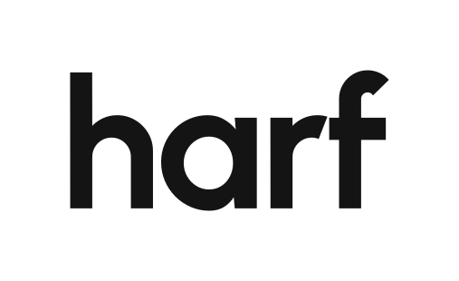
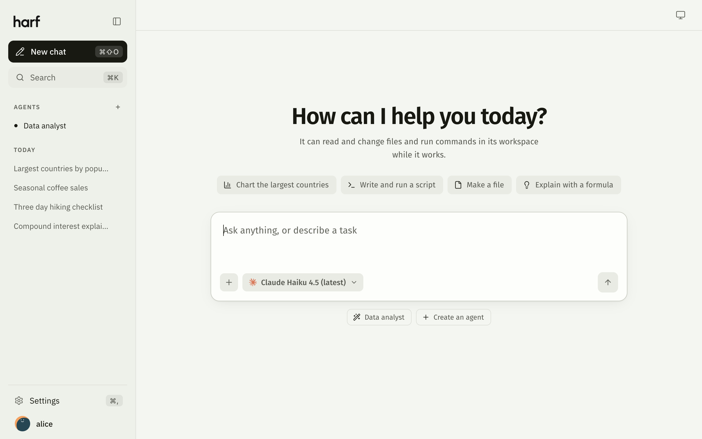

<p align="center">
  <picture>
    <source media="(prefers-color-scheme: dark)" srcset="web/brand/harf-wordmark-paper.svg">
    <source media="(prefers-color-scheme: light)" srcset="web/brand/harf-wordmark-black.svg">
    
  </picture>
</p>

<p align="center"><b>A self-hosted chat interface for the <a href="https://pi.dev">Pi</a> coding agent.</b></p>

<p align="center">One Go binary. Chat in the browser while Pi reads files, runs commands and draws charts in a workspace folder.</p>

<p align="center">
  <a href="https://github.com/aktech/harf/actions/workflows/ci.yml"></a>
  <a href="https://github.com/aktech/harf/actions/workflows/image.yml"></a>
  <a href="LICENSE"></a>
  
  <a href="https://github.com/aktech/harf/pkgs/container/harf"></a>
</p>

<picture>
  <source media="(prefers-color-scheme: dark)" srcset="docs/screenshots/home-dark.png">
  <source media="(prefers-color-scheme: light)" srcset="docs/screenshots/home-light.png">
  
</picture>

For each chat Harf runs `pi --mode rpc` and streams Pi's answer to the browser. Pi works in a workspace folder, so a chat can do real work, not just talk.

## Features

- **Any model Pi can use**: pick one per chat; streaming replies with Markdown, math and highlighted code.
- **Steps**: every file Pi reads or writes and every command it runs shows in the reply.
- **Chats**: stop, edit and resend, regenerate, search, pin, rename, export as Markdown.
- **Agents**: saved instructions, model, thinking level and allowed tools; or ask in a chat and Pi builds one.
- **MCP servers**: add a command or a URL in Settings and Pi uses its tools.
- **Plugins**: attachments up to 100 MB, workspace images, charts, sandboxed HTML pages, image generation through OpenRouter.
- **Command palette**, light and dark themes, token and cost stats under each reply, phone layout.
- **Docker image** for `linux/amd64` and `linux/arm64`.

## Quick start

Install Pi 1.4.0 and sign in (run `pi`, then `/login`) or set a provider key, then:

```sh
make build
ANTHROPIC_API_KEY=... ./bin/harf    # http://127.0.0.1:8080
```

Or with Docker:

```sh
docker run -p 8080:8080 -e ANTHROPIC_API_KEY -v harf:/home/user ghcr.io/aktech/harf:main
```

> [!WARNING]
> **Harf has no sign-in of its own**, and Pi runs commands for whoever can reach it. Keep it on localhost, or behind an authenticating reverse proxy. See [security](docs/security.md).

## Develop

```sh
make test    # go vet, Go tests and the web tests (node --test)
make run     # build and run on http://127.0.0.1:8080
```

The web UI is plain JavaScript modules in `web/`, with no build step.

## Documentation

- [Configuration](docs/configuration.md): environment variables, MCP servers, plugins
- [Deploy with Docker](docs/deploy.md): image tags, volumes, building the image
- [Security](docs/security.md): no sign-in, command execution, MCP servers, `/api/me` headers

## License

[Apache License 2.0](LICENSE). The libraries, fonts, logos and icons in `web/vendor/`, `web/fonts/`, `web/logos/` and `web/icons/` keep their own licences, which sit next to them.
